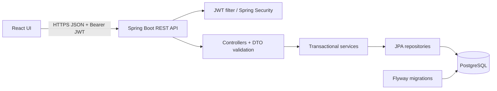
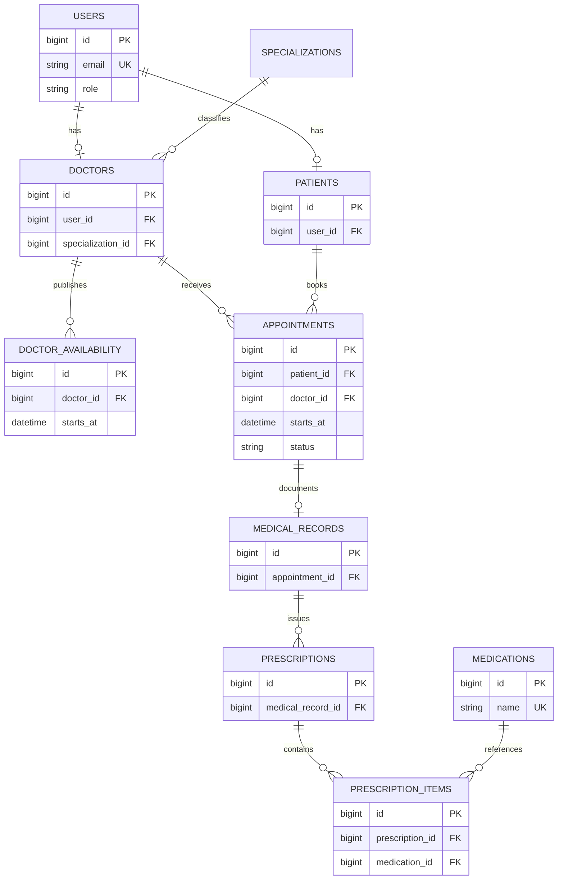
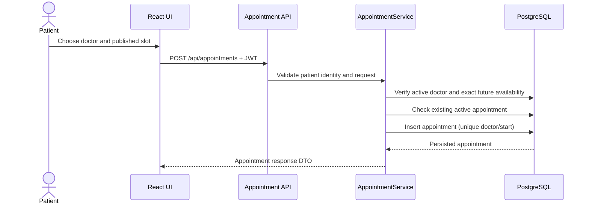
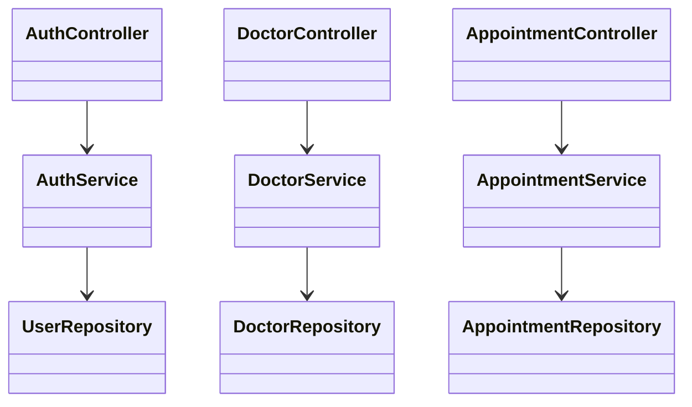

# System design

## Architecture

## ER diagram

The schema is normalized around account identity, patient/doctor profile, specialization, published slots and appointment facts. A unique `(doctor_id, starts_at)` constraint on availability and a partial unique index on active appointments prevent duplicate slots/bookings while allowing cancelled slots to be reused. Indexes support doctor slot lookup and patient/doctor appointment history.

## Booking sequence

## Core class relationships

## API conventions

JSON DTOs are the contract. Authentication uses `Authorization: Bearer <token>`. The UI stores the token in session storage and attaches it to API requests. The API returns standard HTTP statuses (400 validation, 401 authentication, 403 ownership/role, 404 missing data, 409 business conflict). Swagger documents endpoint contracts.
